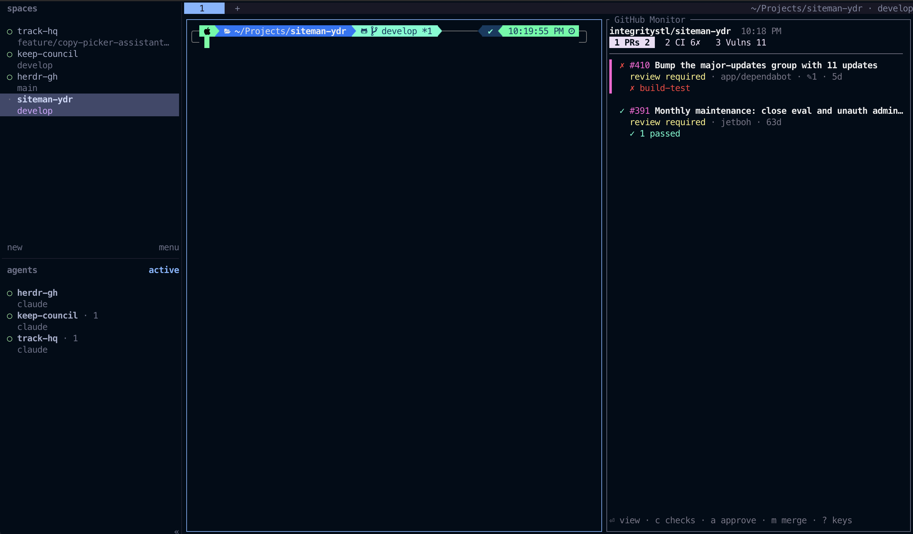
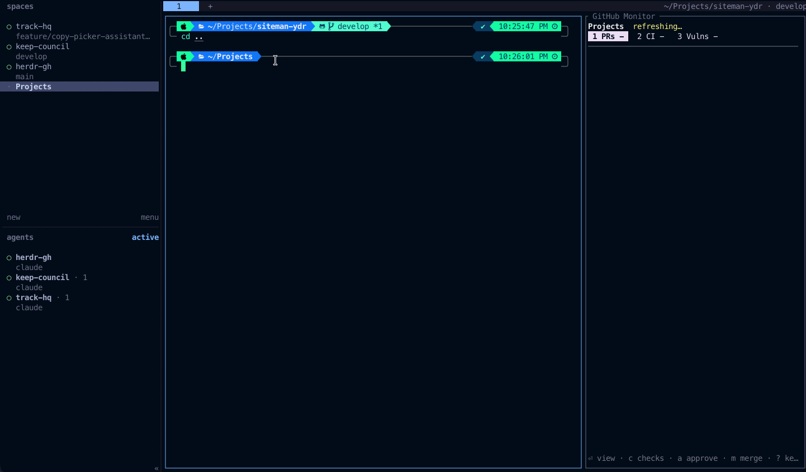
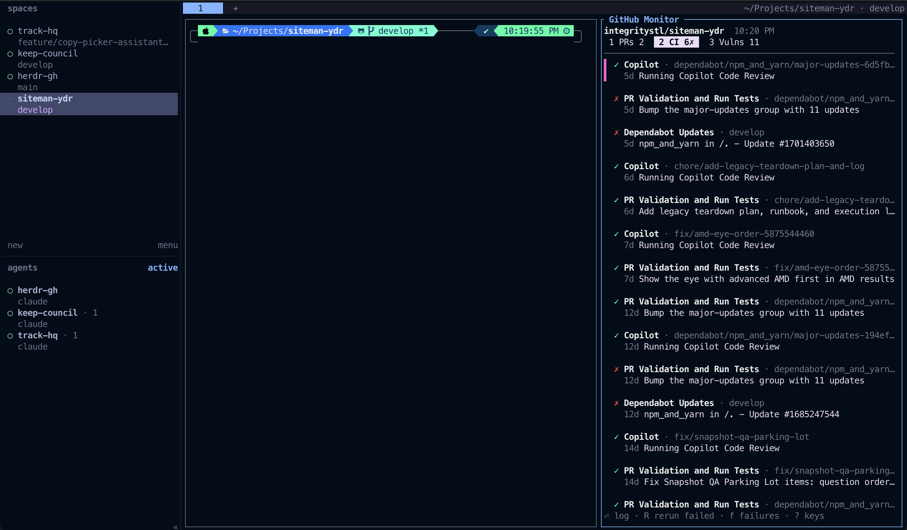
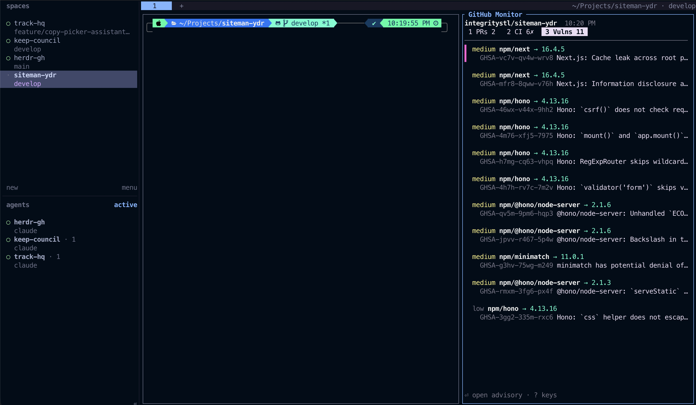
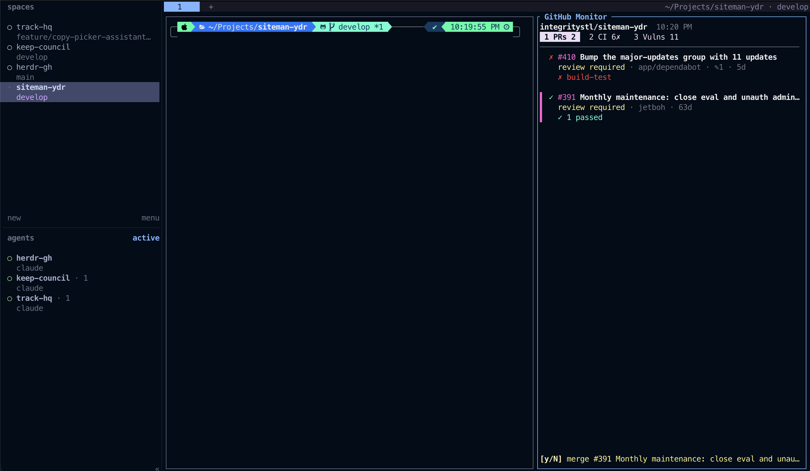
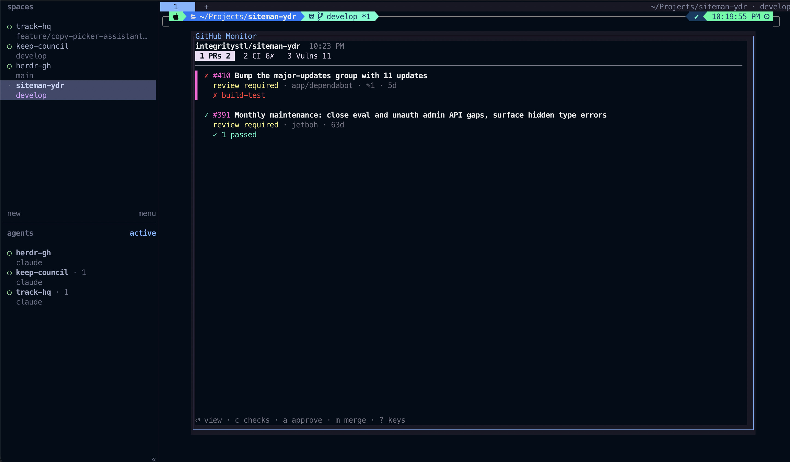

# GitHub Ops for Herdr

Review, merge and fix CI for the repo you're working on without leaving [Herdr](https://herdr.dev). GitHub Ops (`herdr-gh`) puts the current Space's PRs with live checks, Actions runs and Dependabot alerts in a panel beside your agents, and lets you approve, merge, rerun and read failed logs from it.



Each Herdr Space maps to the GitHub repo with the same name: in a Space called `my-app` the plugin finds the repo named `my-app` owned by you or one of your orgs, and shows:

| Tab       | Shows                                                                                 | Actions                                                                               |
| --------- | ------------------------------------------------------------------------------------- | ------------------------------------------------------------------------------------- |
| **PRs**   | Open PRs with each failing/pending check by name, review status, author, comments     | View PR + comments, view all checks, approve, merge, `@dependabot rebase`, open in browser |
| **CI**    | Recent GitHub Actions runs                                                            | Read the failed-job log (or run summary), rerun failed jobs, open in browser           |
| **Vulns** | Open Dependabot alerts (GHSA id, severity, package, fixed version)                    | Open the advisory in browser                                                          |

Approve, merge, rerun and comment always ask for `y` confirmation first, and the prompt names the PR or run it will act on. Approve and merge are pinned to the commit you were looking at: if someone pushes in the meantime, the merge is refused instead of merging code you haven't seen.

Herdr names a Space after the folder of its first pane, so `cd` into another repo and the panel switches to it within a couple of seconds. If no repo matches the Space name, the panel says so; `cd` into a repo or rename the Space to the repo name and press `r`. When several of your repos share the name (e.g. across orgs), originals win over forks, then the most recently pushed one; the header shows how many others matched.



### Screenshots

| CI | Vulns |
| -- | ----- |
|  |  |
| **Confirm before acting** | **Popup for narrow windows** |
|  |  |

## Requirements

- Herdr 0.9.5+ on macOS or Linux
- Node.js 22+ (no npm dependencies)
- [GitHub CLI](https://cli.github.com) logged in (`gh auth login`). The plugin calls `gh` for everything, so it never sees your token.
- `less` for the log/PR viewer, and `open` (macOS) or `xdg-open` (Linux) for the browser

Dependabot alerts need a token that can read them. If the Vulns tab shows `HTTP 403` with a permissions message, run `gh auth refresh -s security_events`. Repos with Dependabot alerts turned off say so on the Vulns tab.

## Install

```bash
herdr plugin install bpkennedy/herdr-gh
```

Then bind keys in Herdr's `config.toml` (any free keys work):

```toml
[[keys.command]]
key = "prefix+i"
type = "plugin_action"
command = "bpkennedy.herdr-gh.sidebar"
description = "GitHub Ops (sidebar)"

[[keys.command]]
key = "prefix+shift+i"
type = "plugin_action"
command = "bpkennedy.herdr-gh.popup"
description = "GitHub Ops (popup)"
```

The panel opens two ways:

- **Sidebar** (`prefix+i`): splits the focused pane and puts the panel on the right at about a third of the width. Press again to close it.
- **Popup** (`prefix+shift+i`): opens it floating over everything, for narrow windows. `q` closes it.

Without keybindings: `herdr plugin action invoke bpkennedy.herdr-gh.sidebar`.

## Configure

Optional. The first launch writes defaults to `$(herdr plugin config-dir bpkennedy.herdr-gh)/config.json`:

```json
{
  "refresh_seconds": 120,
  "merge_method": "merge",
  "run_limit": 20
}
```

| Key               | Default    | Meaning                                         |
| ----------------- | ---------- | ----------------------------------------------- |
| `refresh_seconds` | `120`      | Auto-refresh interval (minimum 30)              |
| `merge_method`    | `"merge"`  | `merge`, `squash` or `rebase` for the `m` key   |
| `run_limit`       | `20`       | How many recent CI runs to show                 |

## Keys

Press `?` in the panel for this list.

| Key                 | Where | Does                                                        |
| ------------------- | ----- | ----------------------------------------------------------- |
| `1` `2` `3`, `tab`  | all   | Switch tab                                                  |
| `j`/`k`, arrows     | all   | Move (`g`/`G` top/bottom)                                   |
| `r`                 | all   | Refresh now                                                 |
| `o`                 | all   | Open selected item in the browser                           |
| `q`, `esc`          | all   | Close                                                       |
| `enter`             | PRs   | PR body and comments in `less`                              |
| `c`                 | PRs   | Every check in `less`                                       |
| `a`                 | PRs   | Approve                                                     |
| `m`                 | PRs   | Merge with `merge_method`                                   |
| `b`                 | PRs   | Comment `@dependabot rebase` (Dependabot PRs only)          |
| `d`                 | PRs   | Toggle Dependabot-only filter                               |
| `enter`             | CI    | Failed-job log for failed runs, run summary otherwise       |
| `R`                 | CI    | Rerun failed jobs                                           |
| `f`                 | CI    | Toggle failures-only filter                                 |
| `enter`             | Vulns | Open the alert in the browser                               |

Icons: `✓` passing, `✗` failing, `●` pending or running, `⊘` skipped or cancelled, `·` no checks, `✎3` three comments.

## Known limitations

- **The Space name has to match the repo name.** A repo cloned into a differently named folder, or a Space you renamed by hand, won't find its repo.
- **The sidebar is recognised by its pane label.** If you rename another pane to "GitHub Ops", the sidebar key will close that pane instead of opening a new sidebar.
- **The sidebar splits the focused pane**, so in a tab with several panes it sits beside the focused one rather than spanning the full height.
- Each Space has its own sidebar; open it once per Space.

## Develop

```bash
git clone https://github.com/bpkennedy/herdr-gh && cd herdr-gh
herdr plugin link .
npm test                           # node:test, no dependencies; fakes stand in for gh and herdr
node bin/dashboard.js owner/repo   # run outside Herdr against a specific repo
```

Layout: `bin/open.js` opens/toggles the pane, `bin/dashboard.js` is the panel UI (`createApp` holds all state and key handling), `lib/gh.js` wraps the `gh` CLI, `lib/cards.js` and `lib/text.js` draw the cards.

### Releasing

Herdr reads the plugin version from `herdr-plugin.toml`. Keep `version` there and in `package.json` in step, add a `CHANGELOG.md` entry, then tag the commit `vX.Y.Z` so users can pin it with `herdr plugin install bpkennedy/herdr-gh --ref vX.Y.Z`. `herdr plugin update` follows the ref a user installed from (the default branch unless they pinned a tag).

## License

MIT
